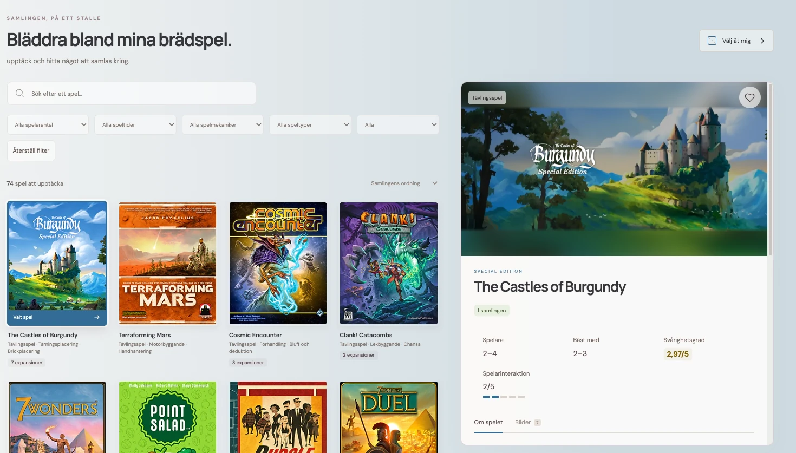

<div align="center">

# Spelhyllan

En brädspelskatalog för att hålla koll på samlingen och välja spel till nästa spelkväll.

[![CI][ci-badge]][ci-url]
[![GitHub-stjärnor][stars-badge]][stars-url]
[![Forkar][forks-badge]][forks-url]
[![Öppna ärenden][issues-badge]][issues-url]
[![Bidragsgivare][contributors-badge]][contributors-url]

[Kom igång](#kom-igång) · [Rapportera ett fel][bug-url] · [Föreslå en funktion][issues-url]

</div>

## Innehåll

- [Om projektet](#om-projektet)
- [Kom igång](#kom-igång)
- [Användning](#användning)
- [Underhåll av katalogen](#underhåll-av-katalogen)
  - [Anslut en egen datakälla i en fork](#anslut-en-egen-datakälla-i-en-fork)
- [Utveckling och publicering](#utveckling-och-publicering)
- [Tack](#tack)

## Om projektet

Spelhyllan visar spel i samlingen och kommande spel. Varje spel har en detaljvy
med beskrivning, spelinformation och galleri. Gränssnittet finns på svenska,
engelska, spanska, tyska och franska.



### Byggd med

[![React][react-badge]](https://react.dev/)
[![TypeScript][typescript-badge]](https://www.typescriptlang.org/)
[![Vite][vite-badge]](https://vite.dev/)
[![Netlify][netlify-badge]](https://www.netlify.com/)

Appen använder CSS Modules och lokala JSON-filer för speldata och
översättningar. Den valfria AI-chatten anropar [Groq](https://groq.com/) via en
Netlify Function.

### Varför lokala filer?

Jag har valt att spara speldata och översättningar i JSON-filer i repot.
Innehållet i samlingen ändras ganska sällan, så en ändring i filerna följd av
en ny publicering räcker för mitt behov. Katalogen kan publiceras statiskt,
och jag slipper drifta och betala för en server eller databastjänst som måste
vara igång hela tiden.

## Kom igång

### Förutsättningar

Installera Git och Node.js 22.13.0 eller senare i 22-serien, alternativt Node.js
24 eller senare. GitHub Actions och Netlify använder Node.js 22.23.4.

### Installation

```bash
git clone https://github.com/Willi0t/board-game-catalog.git
cd board-game-catalog
npm ci
npm run dev
```

Öppna adressen som Vite skriver ut i terminalen. Katalogen och den manuella
spelguiden kan köras direkt med dessa kommandon.

## Användning

- **Utforska** katalogen med sökning, filter för bland annat speltyp, mekanik och
  spelarantal samt sortering.
- **Öppna ett spel** för att se beskrivningen, galleriet och eventuella
  expansioner. Språket går att byta medan detaljvyn är öppen.
- **Spara favoriter** för snabb åtkomst. De sparas i den aktuella webbläsaren.
- **Välj åt mig** öppnar den manuella spelguiden eller den lösenordsskyddade
  AI-chatten. Chattens rekommendationer visas i katalogen.

### Aktivera AI-chatten

Skapa en lokal `.env` med variablerna nedan och starta appen med
`npx netlify-cli dev`.

| Variabel                     | Värde                                                       |
| ---------------------------- | ----------------------------------------------------------- |
| `GROQ_API_KEY`               | API-nyckel från [GroqCloud](https://console.groq.com/keys). |
| `GAME_PICKER_PASSWORD_HASH`  | Saltad scrypt-hash av chattens lösenord.                    |
| `GAME_PICKER_SESSION_SECRET` | Separat slumpvärde från `openssl rand -hex 32`.             |

Skapa lösenordshashen i Bash och spara resultatet som
`GAME_PICKER_PASSWORD_HASH`.

```bash
read -rsp 'Lösenord för chatten: ' picker_password; printf '\n'
printf '%s' "$picker_password" | node -e 'const { randomBytes, scryptSync } = require("node:crypto"); const salt = randomBytes(16); const hash = scryptSync(require("node:fs").readFileSync(0), salt, 32, { N: 65536, r: 8, p: 1, maxmem: 96 * 1024 * 1024 }); console.log(salt.toString("hex") + ":" + hash.toString("hex"));'
unset picker_password
```

## Underhåll av katalogen

| Innehåll                                              | Plats                                           |
| ----------------------------------------------------- | ----------------------------------------------- |
| Speldata och engelska källtexter                      | [`src/games.json`](src/games.json)              |
| Svenska, spanska, tyska och franska spelbeskrivningar | `src/data/descriptions/`, en JSON-fil per språk |
| Översättningar av gränssnittet                        | `src/i18n/`                                     |
| Spelbilder och reservillustrationer                   | [Bildguiden](public/images/README.md)           |

Använd spelets befintliga `id` som nyckel i språkfilerna och som mappnamn för
bilder under `public/images/games/`. Saknas en översättning används källtexten i katalogen. När omslaget byts kan du uppdatera bildvarianterna med
`npm run covers:generate`. Använd vid behov
`node scripts/cover-theme.mjs <spel-id>` för att förhandsgranska temafärger och
lägg till `--write` för att spara dem.

### Importera speldata från Sheets

1. Exportera de första nio kolumnerna inklusive `Expansions` till
   `catalog-data.json`. Utelämna kolumnen Notes/Notering.
2. Granska källrader och speltitlar i
   [`scripts/catalog-matches.json`](scripts/catalog-matches.json). Behåll
   befintliga spel-ID:n och ange titel och utgåva separat.
3. Kör `node scripts/import-catalog.mjs`. Importen uppdaterar katalogmetadata
   och bevarar lokala beskrivningar, bilder och färger.
4. Kör projektkontrollerna nedan. Uppdatera Sheets-underlaget när ett kommande
   spel flyttas till samlingen, så att nästa import behåller rätt status.

### Anslut en egen datakälla i en fork

Spelvyerna använder samma datastruktur oavsett var innehållet lagras. I en
fork kan du börja med att byta hur katalogen får sin data.

- **Google Sheets:** Utgå från importen ovan. För att automatisera den kan du
  hämta rader via Sheets API, mappa dem till importformatet och köra
  `scripts/import-catalog.mjs` före bygget. Då kan katalogen fortsätta
  publiceras statiskt. Lägg åtkomstuppgifter för ett privat kalkylark i
  byggmiljön.
- **Databas:** Lägg upp katalogen i en databas med ett stabilt `id` per spel.
  Skapa ett API som läser spelposterna och returnerar JSON enligt typen
  [`Game`](src/types/game.ts). Anpassa datainläsningen i
  [`src/data/games.ts`](src/data/games.ts) och där den används så att appen
  hämtar katalogen från API:t. Lägg till laddnings- och fellägen. Databasens
  åtkomstuppgifter hör hemma i API:ets miljö.

Behåll spelens ID:n så att favoriter, bilder och översättningar fortsätter att
peka på rätt spel. Om du använder AI-chatten behöver även Netlify-funktionen
läsa samma katalog. Den läser i dag `src/games.json`.

## Utveckling och publicering

```bash
npm run format:check
npm run lint
node --test tests/*.test.mjs
npm run build
```

Använd `npm run format` för att formatera filer. Bygget kör typkontroll och
kontrollerar omslagsvarianter innan Vite skriver resultatet till `dist/`.
Förhandsgranska produktionsbygget med `npm run preview`.

[GitHub Actions](.github/workflows/ci.yml) kör formatering, lint och bygge vid
pushar till alla grenar och pull requests till `main`. [`netlify.toml`](netlify.toml) anger
`npm run build` och `dist/` som byggkommando och publiceringsmapp. För
AI-chatten i produktion lägger du in miljövariablerna i Netlify med åtkomst för
Functions och gör en ny deploy.

## Tack

README-strukturen är inspirerad av
[Best README Template](https://github.com/othneildrew/Best-README-Template).

[Tillbaka till toppen](#spelhyllan)

[ci-badge]: https://github.com/Willi0t/board-game-catalog/actions/workflows/ci.yml/badge.svg?branch=feat%2Fui-copy-and-localization
[ci-url]: https://github.com/Willi0t/board-game-catalog/actions/workflows/ci.yml
[stars-badge]: https://img.shields.io/github/stars/Willi0t/board-game-catalog?style=flat&logo=github
[stars-url]: https://github.com/Willi0t/board-game-catalog/stargazers
[forks-badge]: https://img.shields.io/github/forks/Willi0t/board-game-catalog?style=flat&logo=github
[forks-url]: https://github.com/Willi0t/board-game-catalog/forks
[issues-badge]: https://img.shields.io/github/issues/Willi0t/board-game-catalog?style=flat&logo=github
[issues-url]: https://github.com/Willi0t/board-game-catalog/issues
[bug-url]: https://github.com/Willi0t/board-game-catalog/issues/new
[contributors-badge]: https://img.shields.io/github/contributors/Willi0t/board-game-catalog?style=flat&logo=github
[contributors-url]: https://github.com/Willi0t/board-game-catalog/graphs/contributors
[react-badge]: https://img.shields.io/badge/React-20232A?style=flat&logo=react&logoColor=61DAFB
[typescript-badge]: https://img.shields.io/badge/TypeScript-3178C6?style=flat&logo=typescript&logoColor=white
[vite-badge]: https://img.shields.io/badge/Vite-646CFF?style=flat&logo=vite&logoColor=white
[netlify-badge]: https://img.shields.io/badge/Netlify-004D4D?style=flat&logo=netlify&logoColor=white
